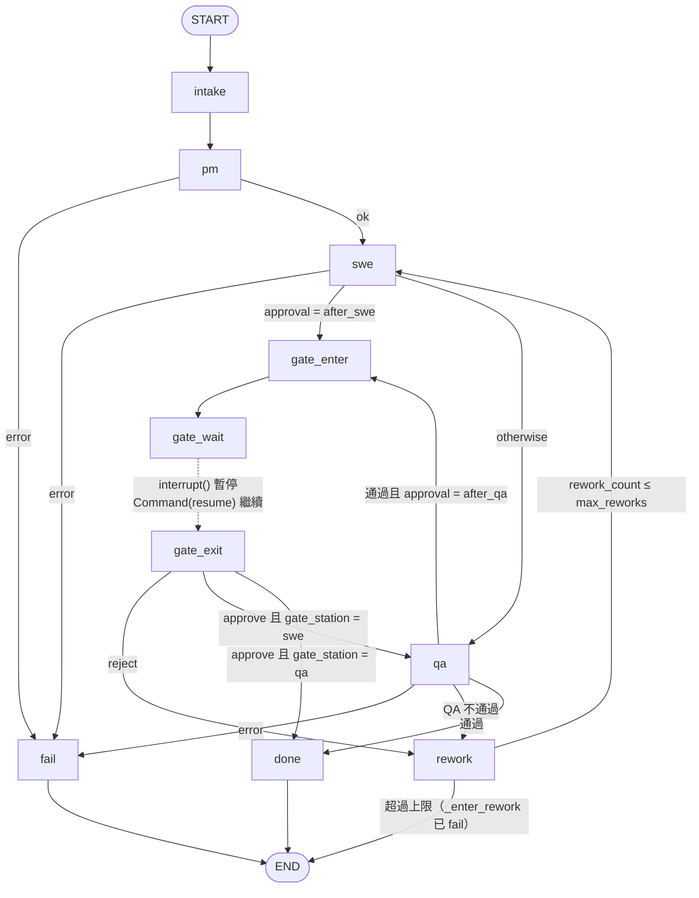

# Plan：Pipeline 改造成 LangGraph

Status: CONFIRMED（2026-11-16，使用者確認）

> 依據：`specs/langgraph-pipeline/spec.md`（DRAFT）。現有程式的描述以 2026-11-15 實際讀到的程式碼為準；與使用者原始描述不同之處列在 spec §4。
> LangGraph API 的描述來自 **langgraph 1.2.22** wheel 的原始碼（用 `pip download --no-deps` 下載後直接讀，沒有安裝進專案）；每一項都附檔案位置，執行者在 Task 8 會用煙霧測試再驗證一次。

## Approach

保留 `PipelineOrchestrator` 這個外殼（佇列、worker、事件出口、閘門登記、計數器、snapshot 全部不動），只把 `process_task()` 的流程控制換成一個 compiled `StateGraph`：

```
enqueue ──► PriorityQueue ──► _worker_loop ──► process_task(task)
                                                   │
                         PIPELINE_ENGINE=legacy ───┼──► 原本的 while 迴圈（_process_task_legacy）
                                                   │
                      PIPELINE_ENGINE=langgraph ───┴──► PipelineGraphRunner.run(task)
                                                          ├─ graph.astream(...)        ← 跑到 END 或停在 interrupt
                                                          ├─ await orch._gate_wait()   ← 停在閘門時在 event loop 上等決定
                                                          └─ graph.astream(Command(resume=...))
```

兩個引擎呼叫**同一組**私有 helper（`_run_station`、`_persist_deliverable`、`_record_usage`、`_enter_rework`、`_fail_task`、`_gate_enter`、`_gate_exit`…），事件也都由這些 helper 透過同一個 `_emit` 發出。所以事件契約不是靠「重寫得一模一樣」來保證，而是靠「共用同一份副作用程式碼，graph 只負責決定下一步」。graph 本身只做流程控制，這也是 LangGraph 最適合拿來學的部分。

新程式集中在 `backend/core/pipeline_graph.py`（state、node、routing、builder、runner），`pipeline.py` 只多一個引擎分派與幾個從 legacy 抽出來的 helper。

## Alternatives Considered

1. **整個 orchestrator 重寫成 LangGraph（佇列、排程也放進 graph）。** 學到的東西更多，但佇列與優先序和 LangGraph 無關，會把「行為不變」的驗證範圍擴大到排程與執行緒，風險高、對學習沒幫助。不採用。
2. **graph node 直接 `await` 閘門的 `asyncio.Event`，不用 `interrupt()`。** 在 `InMemorySaver` 階段功能完全等價、程式更短，但學不到 interrupt／Command，也做不到「重啟後續跑」。不採用；不過 plan 會明講：**interrupt 的實際價值要到選配 O3（持久化 checkpointer）才真正顯現**，第一階段主要是學語意。
3. **`approve()`／`reject()` 直接呼叫 `graph.ainvoke(Command(resume=...))`。** 使用者原始傾向。問題：REST 端點是同步 `def`，FastAPI 在 threadpool 的執行緒呼叫它，那裡沒有 event loop；就算用 `run_coroutine_threadsafe` 丟回 loop，也會變成「worker 的 process_task」與「REST 觸發的 resume」兩個呼叫者在跑同一個 thread_id，`process_task` 何時返回、`done_count` 何時加一都變得難以推理。不採用，改為 D4 的 driver 模式。
4. **事件改用 `get_stream_writer()` 送到 custom stream，由 driver 轉成 `on_event`。** 見 D5，主流程不採用，留給選配 O1 示範。
5. **兩個閘門各做一組 node（`gate_swe_*`、`gate_qa_*`）。** 圖比較直觀，但同樣的冪等規則要維護兩份。改用一組三個 node，以 state 的 `gate_station` 區分（D7）。

## Architecture / Design Decisions

每個決策都寫「選了什麼／為什麼／放棄了什麼」。

**D1 邊界：保留 `PipelineOrchestrator` 公開介面，只換 `process_task` 內部**
- 選了：`process_task(task)` 依引擎分派；`enqueue/start/stop/_worker_loop/approve/reject/_resolve_gate/is_awaiting_approval/snapshot/queue_size/is_budget_paused` 一行都不改。`runtime.py`、`api/*`、`ws_manager.py`、前端零修改。
- 為什麼：事件與 snapshot 由同一個物件產生，契約自然不變；測試 `tests/test_pipeline.py` 直接呼叫 `process_task()` 並在等待時讀 live `Task`，這個介面必須保留。
- 放棄了：一個「純」LangGraph 的 orchestrator（Alternatives 1）。

**D2 Feature flag**
- 選了：`config.get_pipeline_engine()` 讀環境變數 `PIPELINE_ENGINE`，合法值 `legacy`、`langgraph`，未設定或空字串為 `legacy`，其他值拋 `ValueError("PIPELINE_ENGINE must be one of: legacy, langgraph (got '...')")`。`PipelineOrchestrator.__init__` 新增最後一個關鍵字參數 `engine: str | None = None`，`None` 時讀環境變數。引擎為 `langgraph` 時才在 `__init__` 內 `from core.pipeline_graph import PipelineGraphRunner`（延遲 import，legacy 不載入 langgraph）。`docker-compose.yml` 的 backend `environment` 加一行 `- PIPELINE_ENGINE=${PIPELINE_ENGINE:-legacy}`。
- 為什麼：整套既有測試（含 `test_api.py` 透過 runtime 建的 orchestrator）不必改任何一行，只要 `PIPELINE_ENGINE=langgraph pytest` 就能在新引擎上重跑，這是最便宜也最完整的對照。
- 放棄了：設定檔或 per-project 開關（個人專案不需要）。

**D3 State 只放可序列化的流程資料；live `Task` 放在 graph 外**
- 選了：runner 持有 `self._live_tasks: dict[str, Task]`，node 用 `state["task_id"]` 取出 live `Task`。state 只放字串、布林、整數、字串清單。每個 node 照 legacy 的時機同步更新 live `Task` 欄位（`task.pm_output = ...`、`task.rework_count` 由 `_enter_rework` 加一）。
- 為什麼：`InMemorySaver.put` 會用 `serde.dumps_typed` 把 state 序列化（`langgraph/checkpoint/memory/__init__.py` 第 457–463 行），resume 後 node 拿到的是**反序列化的複本**，不是原物件。但 (a) `BaseAgent.run()` 會直接改 `task.status`，(b) SWE prompt 讀 `task.rework_count`，(c) 測試在閘門等待中斷言 `task.swe_output is not None`，(d) `_task_summary(task)` 是所有事件 `data["task"]` 的來源。這些都需要同一個物件。
- 放棄了：把 `Task`（pydantic model）整個放進 state。看起來比較「LangGraph 風格」，但會造成兩份真相，resume 後還會分岔。`tests/test_langgraph_semantics.py` 會有一個測試示範這個陷阱（放進 state 的物件在 resume 後 `is` 不再成立）。

**D4 閘門：`interrupt()` + `Command(resume=...)`，由 event loop 上的 driver 送出 resume**
- 選了：
  1. `gate_enter` node：呼叫 `orch._gate_enter(task, station)`。這是從 legacy `_await_approval` 抽出的前半段：建立 `asyncio.Event` 放進 `_approval_gates`、寫入 `_awaiting`、`_set_station(station, "awaiting_approval")`、寫 `awaiting_approval` 狀態、發 `task:awaiting_approval`。
  2. `gate_wait` node：**只有** `answer = interrupt({...})` 與 `return {"decision": ..., "decision_note": ...}`。
  3. driver（`PipelineGraphRunner.run`）：`astream` 結束後用 `aget_state(config)` 檢查；`snapshot.next` 非空表示停在 interrupt，就 `decision, note = await orch._gate_wait(task)`（legacy 後半段的等待：`await event.wait()`、`finally` 清 `_approval_gates`／`_awaiting`、取出 `_approval_decisions`），再用 `Command(resume={"decision": decision, "note": note})` 繼續跑。
  4. `gate_exit` node：呼叫 `orch._gate_exit(task, station, decision, note)`（legacy 的收尾：`_set_station(idle)`、寫 `in_progress`、發 `task:approved` 或 `task:rejected`）。
  5. `approve()`／`reject()`／`_resolve_gate()` **完全不改**。
- 為什麼：閘門登記在 `gate_enter`（interrupt 之前）就完成，所以 `is_awaiting_approval()`、`snapshot()["awaiting_approval"]`、`approve()` 的回傳值三者一致，與 legacy 相同；若 approve 在 graph 真正停下之前就到達，`Event` 已經 set，driver 一進入 `_gate_wait` 就立刻返回，不會遺失決定。graph 永遠只在 event loop 上、由同一個 driver 執行（見 §7 規則 T1）。
- 放棄了：Alternatives 3（REST 執行緒直接 resume）。

**D5 事件：node 內直接呼叫共用 helper 的 `_emit`；`astream` 用 `stream_mode="updates"`**
- 選了：所有事件仍由共用 helper `await self._emit(...)` 發出，發生在 node 內部，時機與 legacy 一致。driver 用 `graph.astream(input, config, stream_mode="updates")` 驅動 graph，每個 chunk 只寫 `logger.debug`（學習用：看每個 node 回傳了什麼 state 更新）。
- 為什麼：
  - **順序與背壓完全相同**：legacy 是 `await on_event(...)` 之後才繼續；node 內直接 await 也是。改用 stream writer 的話，事件先進 LangGraph 的串流佇列，由 driver 在另一個時間點轉發，node 可能已經往下跑（例如已經開始寫檔），事件與副作用的相對時機會變，`test_api.py` 這類「看到事件就去讀檔」的測試可能偶發失敗。
  - **不用改 helper 簽章**：`_run_station`、`_record_usage`、`_check_budget`、`_enter_rework`、`_fail_task` 都直接呼叫 `self._emit`；若改成 writer，要嘛每個 helper 加 `emit` 參數，要嘛做執行期替換，兩者都會動到 legacy。
  - **不阻塞 event loop**：node 是 `async def`，agent 仍經由 `_run_station` 裡的 `asyncio.to_thread(agent.run, ...)` 執行，與 legacy 相同；檔案寫入也一樣在 `to_thread`。
  - **rework 重複進入 node**：每次進入 `swe`／`qa` node 都呼叫一次 `_run_station`，發一次 `working` 與一次 `done/error`，與 legacy 每圈迴圈呼叫一次 `_run_station` 完全對應；`rework` 事件只在 `rework` node 發一次。
- 放棄了：`get_stream_writer()` 作為主要事件通道。保留為選配 O1：用 custom stream 送一個**不進 `on_event`** 的除錯進度訊息，學 `stream_mode=["updates", "custom"]` 的用法。

**D6 Checkpointer 與 thread_id**
- 選了：每個 orchestrator（每個 project）一個 `InMemorySaver`；`thread_id = f"{project_id}:{task.id}"`。每次 `run()` 開始前 `await checkpointer.adelete_thread(thread_id)`，跑到 END 後再刪一次。
- 為什麼：同一個 task id 可能再被處理（例如手動把 tasks.yaml 改回 pending 後重啟），舊 checkpoint 裡沒被新輸入覆寫的 channel（`rework_count`、`deliverables` 等）會殘留，造成難查的錯誤。開始前刪除保證每次都是全新執行；結束後刪除避免記憶體隨任務數成長。單一 worker 保證同一時間同一 thread_id 只有一個執行者。
- 放棄了：`thread_id = task.id`（多專案時可能撞號）、每次用 uuid（選配 O3 重啟後找不回來）。選配 O3 改成持久化時，「開始前刪除」要改為「若有未回答的 interrupt 則 resume，否則刪除」，見 tasks.md O3。

**D7 一組閘門 node，以 `gate_station` 區分**
- 選了：`swe` 與 `qa` node 都在回傳中設定 `gate_station`（`"swe"`／`"qa"`），條件邊決定要不要進 `gate_enter`；`gate_exit` 之後依 `decision` 與 `gate_station` 決定去 `qa`、`done` 或 `rework`。
- 為什麼：三段式（enter／wait／exit）才是要學的模式；只寫一份，冪等規則只需要在一處遵守。
- 放棄了：兩組各三個 node（Alternatives 5）。

**D8 重工上限沿用 `_enter_rework` 的行為**
- 選了：`rework` node 呼叫既有的 `orch._enter_rework(task, state["rework_reason"])`。它在超過上限時**自己**呼叫 `_fail_task` 並回傳 task；node 據此回傳 `{"outcome": "failed"}`，條件邊導向 END。站點本身失敗（agent 回傳 `success=False`）才走 `fail` node。
- 為什麼：失敗原因字串（`"QA still failing after {max_reworks} reworks"`、`"Rejected at approval gate (after SWE)"`、`"Rejected at approval gate (after QA)"`）與事件順序直接沿用，不必重寫。
- 放棄了：把「超過上限」改成獨立 node（圖較漂亮，但要複製 `_enter_rework` 的邏輯）。

**D9 recursion_limit 明確設定**
- 選了：config 帶 `"recursion_limit": 20 + 12 * (task.max_reworks + 1)`。
- 為什麼：每圈重工最多經過約 9 個 node（swe、gate×3、qa、gate×3、rework）。1.2.22 的預設上限是 10007（`langgraph/_internal/_config.py`，可由 `LANGGRAPH_DEFAULT_RECURSION_LIMIT` 覆寫），但舊版文件與許多範例寫的是 25；明確設定可避免版本差異造成 `GraphRecursionError`。上限是**每次呼叫**計算（`_loop.py` 第 1923 行 `self.stop = self.step + recursion_limit + 1`，`step` 從 checkpoint 接續）。
- 放棄了：依賴預設值。

**D10 測試策略：先特徵化，再兩引擎同測**
- 選了：先在 legacy 上寫 `tests/test_pipeline_characterization.py`（§6 的 12 個劇本，期望值寫死），通過後才開始寫 graph；之後同一份測試以 `@pytest.mark.parametrize("engine", ["legacy", "langgraph"])` 在兩個引擎上跑。既有測試檔不改，以 `PIPELINE_ENGINE=langgraph` 整套重跑。
- 為什麼：期望值寫死在測試裡（而不是「兩個引擎互相比」），legacy 在重構期間被改壞也會被抓到。
- 放棄了：只做兩引擎互比的 golden diff（無法偵測兩邊一起壞掉）。

**D11 相依套件**
- 選了：`requirements.txt` 新增 `langgraph==1.2.22`（2026-11-15 PyPI 最新穩定版）。不另外釘傳遞相依，但 Task 8 完成時把 `pip freeze | grep -iE "^lang|ormsgpack|xxhash"` 的結果記在 tasks.md 該項下。`langchain-core`（1.8.0 時點）是 langgraph 的必要相依，所以選配 O4 的 `FakeListChatModel` 不需要新套件。
- 為什麼：只釘主套件，傳遞相依由 pip 解決，個人專案夠用；版本記錄可供日後重現。
- 放棄了：lock 檔工具（uv/pip-tools），本專案目前沒有用。

## Graph



## State schema

```python
# backend/core/pipeline_graph.py
import operator
from typing import Annotated, Literal, TypedDict

class PipelineState(TypedDict, total=False):
    task_id: str                       # 用來從 runner._live_tasks 取 live Task（D3）
    approval: str                      # task.approval.value，給條件邊用，intake 時寫入
    pm_output: str | None
    swe_output: str | None
    qa_output: str | None
    qa_passed: bool
    approval_feedback: str | None      # reject 的 note；SWE 成功後清成 None
    rework_count: int                  # 鏡像 task.rework_count（真正的計數在 _enter_rework）
    rework_reason: str | None          # 若這次重工超過上限，要用的失敗原因
    gate_station: Literal["swe", "qa"] | None
    decision: Literal["approve", "reject"] | None
    decision_note: str
    # LangGraph 學習: reducer — 每個 node 回傳的清單會被「加」到既有值，而不是覆蓋
    deliverables: Annotated[list[str], operator.add]
    error: str | None                  # 站點失敗原因，有值就走 fail
    outcome: Literal["done", "failed"] | None
```

初始輸入（`intake` 之前）：`{"task_id": task.id, "approval": task.approval.value, "rework_count": task.rework_count, "deliverables": [], "approval_feedback": None, "qa_output": task.qa_output, "pm_output": None, "swe_output": None, "error": None, "outcome": None}`。

## Node 職責

| node | 做什麼（呼叫的共用 helper） | 回傳的 state 更新 | 可能的副作用 |
| --- | --- | --- | --- |
| `intake` | `orch._start_task(task)`：發 `task:created`（含 `queue_size`）、寫 `in_progress` | `{}` | 事件、寫 tasks.yaml |
| `pm` | `_run_station("pm", task, None)`；成功時 `task.pm_output = ...`、`_persist_deliverable` | 成功：`pm_output`、`deliverables`；失敗：`error = result.error or "PM agent failed"` | agent 呼叫、事件、usage、寫檔 |
| `swe` | `ctx = orch._build_swe_context(task, state["approval_feedback"])`；`_run_station("swe", ...)`；成功時 `task.swe_output = ...`、寫交付檔 | 成功：`swe_output`、`approval_feedback=None`、`gate_station="swe"`、`deliverables`；失敗：`error = result.error or "SWE agent failed"` | 同上 |
| `qa` | `_run_station("qa", task, {"swe_output", "pm_output"})`；成功時 `task.qa_output = ...`、寫交付檔；`QAAgent.is_pass(...)` | `qa_output`、`qa_passed`、`gate_station="qa"`、`rework_reason`（未通過時為 `f"QA still failing after {task.max_reworks} reworks"`）、`deliverables`；失敗：`error = result.error or "QA agent failed"` | 同上 |
| `gate_enter` | `orch._gate_enter(task, state["gate_station"])` | `{}` | 閘門登記、事件、寫 tasks.yaml |
| `gate_wait` | **只有** `interrupt(...)` | `decision`、`decision_note` | **無**（規則 I1） |
| `gate_exit` | `orch._gate_exit(task, station, decision, note)` | reject 時：`rework_reason = f"Rejected at approval gate (after {station.upper()})"`、`approval_feedback = note` | 事件、寫 tasks.yaml |
| `rework` | `failed = await orch._enter_rework(task, state["rework_reason"])` | `rework_count = task.rework_count`；`outcome = "failed"` 若 `failed is not None` | 事件（rework 或 failed）、寫 tasks.yaml |
| `done` | `orch._complete_task(task, state["deliverables"])`：寫 `done`、`done_count += 1`、發 `task:completed` | `outcome = "done"` | 事件、寫 tasks.yaml、計數 |
| `fail` | `orch._fail_task(task, state["error"])` | `outcome = "failed"` | 事件、寫 tasks.yaml、計數 |

`_start_task`、`_build_swe_context`、`_complete_task`、`_gate_enter`、`_gate_wait`、`_gate_exit` 是 Task 6 從 legacy `process_task`／`_await_approval` 原樣抽出的 helper，legacy 也改成呼叫它們（純重構，特徵化測試必須保持綠燈）。`_build_swe_context` 必須保留 legacy 的細節：`qa_output` 只有在 `task.qa_output is not None` 時加入；`approval_feedback` 只有在 note **為真值**（非空字串）時加入。

## Driver（runner）

```python
class PipelineGraphRunner:
    def __init__(self, orch: "PipelineOrchestrator") -> None:
        self._orch = orch
        self._live_tasks: dict[str, Task] = {}
        self._checkpointer = InMemorySaver()          # LangGraph 學習: checkpointer
        self._graph = build_graph(self).compile(checkpointer=self._checkpointer)

    async def run(self, task: Task) -> Task:
        thread_id = f"{self._orch.project_id}:{task.id}"   # LangGraph 學習: thread_id
        config = {"configurable": {"thread_id": thread_id},
                  "recursion_limit": 20 + 12 * (task.max_reworks + 1)}
        await self._checkpointer.adelete_thread(thread_id)
        self._live_tasks[task.id] = task
        graph_input = initial_state(task)
        try:
            while True:
                # LangGraph 學習: astream(stream_mode="updates") 每個 node 結束送出一個 {node: update}
                async for chunk in self._graph.astream(graph_input, config, stream_mode="updates"):
                    logger.debug("graph %s update: %s", thread_id, chunk)
                state = await self._graph.aget_state(config)
                if not state.next:          # 跑到 END
                    break
                # 停在 gate_wait 的 interrupt：在 event loop 上等人工決定（D4）
                decision, note = await self._orch._gate_wait(task)
                # LangGraph 學習: Command(resume=...) 讓 gate_wait 從頭重跑，interrupt() 這次回傳 resume 值
                graph_input = Command(resume={"decision": decision, "note": note})
            await self._checkpointer.adelete_thread(thread_id)
            return task
        finally:
            self._live_tasks.pop(task.id, None)
```

`process_task` 在 langgraph 引擎下就是 `return await self._graph_runner.run(task)`。node 內的例外會從 `astream` 往外拋，由既有 `_worker_loop` 的 `except Exception` 處理成 `"internal pipeline error"`，與 legacy 相同（Task 8 驗證例外是否原樣拋出，見 §9）。

## 事件對應表

| legacy 事件／動作 | 發生位置（legacy） | LangGraph 引擎中的位置 | 機制 |
| --- | --- | --- | --- |
| `task:created` + 寫 `in_progress` | `process_task` 開頭 | `intake` node | 共用 `_start_task` |
| `station:update working` → `done`/`error` | `_run_station` | `pm`／`swe`／`qa` node | 共用 `_run_station` |
| `usage:update` | `_record_usage`（`_run_station` 末尾） | 同上 | 共用 |
| `devops:alert`（預算，critical，只在轉入暫停時一次） | `_check_budget` | 同上 | 共用 |
| 交付檔寫入 | `_persist_deliverable` | `pm`／`swe`／`qa` node | 共用；路徑累積在 state `deliverables`（reducer） |
| `task:awaiting_approval` + 寫 `awaiting_approval` + `station_states=awaiting_approval` | `_await_approval` 前半 | `gate_enter` node | 共用 `_gate_enter` |
| 等待人工決定 | `_await_approval` 中間 `await event.wait()` | driver（`gate_wait` 的 interrupt 之後） | 共用 `_gate_wait` + `interrupt`／`Command` |
| `task:approved`／`task:rejected` + 寫 `in_progress` + `station_states=idle` | `_await_approval` 後半 | `gate_exit` node | 共用 `_gate_exit` |
| `station:update rework` 或（超過上限）`task:failed` | `_enter_rework` | `rework` node | 共用 `_enter_rework` |
| `task:failed`（站點失敗） | `_fail_task` | `fail` node | 共用 `_fail_task` |
| `task:completed` + 寫 `done` | `process_task` 末尾 | `done` node | 共用 `_complete_task` |
| `task:failed`（"internal pipeline error"） | `_worker_loop` | 不變 | 不變 |

## §5 事件簽章（測試與驗收共用）

定義在 `backend/tests/pipeline_harness.py`（測試）與 `backend/scripts/compare_ws_events.py`（驗收，複製同一個函式，不 import tests）：

```python
def event_signature(event: str, data: dict) -> tuple:
    task = data.get("task") or {}
    sig = [event, tuple(sorted(data.keys())), data.get("station"), data.get("status"),
           task.get("id"), task.get("status"), task.get("rework_count")]
    if event == "task:created":
        sig.append(data["queue_size"])
    elif event == "task:completed":
        sig += [data["done_count"], tuple(Path(p).name for p in data["deliverables"])]
    elif event == "task:failed":
        sig += [data["failed_count"], data["reason"]]
    elif event == "task:rejected":
        sig.append(data["note"])
    elif event == "usage:update":
        sig += [data["task_usage"]["call_count"], data["project_usage"]["call_count"]]
    elif event == "devops:alert":
        sig += [data["level"], data["metric"]]
    return tuple(sig)
```

刻意排除：`execution_time`、`error` 的完整內容（只看 `task:failed` 的 `reason`）、token 數與成本、時間戳。

## §6 特徵化劇本

全部以真實的 `PMAgent`／`SWEAgent`／`QAAgent` 搭配劇本化的 LLM client（沿用 `tests/test_pipeline.py` 的 `MockLLMClient` 子類別寫法）執行，`write_status=True`、`write_deliverables=True`，在 `tmp_path` 建 tasks.yaml。每個劇本斷言：事件簽章序列、tasks.yaml 狀態寫入序列（monkeypatch `core.pipeline.write_task_status` 包一層記錄器，仍呼叫原函式）、交付檔名清單（排序後）、最終 `task.status`／`rework_count`／三個 output 是否為 None、`done_count`／`failed_count`、各 client 被呼叫次數。

| # | 劇本 | 重點 |
| --- | --- | --- |
| S1 | 一般流程，approval=none | 基本順序 |
| S2 | QA 第一次 FAIL、第二次 PASS | 一次 rework 事件；交付檔序號 01–05 |
| S3 | QA 永遠 FAIL，max_reworks=2 | 失敗原因 `QA still failing after 2 reworks`；rework 事件 2 次 |
| S4 | SWE client 拋例外 | `station:update error` 的 `task.status` 為 `failed`（agent 自己改的） |
| S5 | PM client 拋例外 | SWE、QA 從未被呼叫 |
| S6 | after_swe，approve | 等待中 `snapshot()` 與 `station_states` 的內容；QA 在 approve 後才跑 |
| S7 | after_qa，approve | 等待中 `qa_output` 已有值 |
| S8 | after_swe，reject("Please add input validation") 後 approve | SWE 第二次 prompt 含 note |
| S9 | after_swe，max_reworks=1，reject 兩次 | 失敗原因 `Rejected at approval gate (after SWE)` |
| S10 | after_qa，reject("tighten tests") 後 approve | SWE 第二次 context 同時有 qa_output 與 note；QA 跑兩次 |
| S11 | 帶 `UsageTracker(project_budget_usd=0.015)` 並預先記一筆 0.02 的花費 | `usage:update` ×3；`devops:alert` 恰一次且在第一個 `usage:update` 之後；任務仍 done |
| S12 | after_swe，reject("")（空 note）後 approve | 空 note 不加入 `approval_feedback`（以 legacy 實測結果為準） |

**期望值一律以 legacy 實際跑出的結果為準。** 如果實測與上表的「重點」描述不一致，以實測為準寫進測試，並在 tasks.md 該項下註記差異。

## §7 Thread-safety 規則

- **T1** graph 只會在 orchestrator 的 event loop 上、由 `PipelineGraphRunner.run()` 執行。任何其他地方（`approve()`、`reject()`、REST 端點、watchdog 執行緒）都不得呼叫 `astream`／`ainvoke`／`aupdate_state`／`aget_state`。
- **T2** `approve()`／`reject()` 只動 `_approval_gates`、`_awaiting`、`_approval_decisions` 三個 dict，並在 loop 執行中時以 `call_soon_threadsafe(event.set)` 喚醒，即現有的 `_resolve_gate`，不修改。（這三個 dict 的跨執行緒存取依賴 CPython 單一 dict 操作的原子性，legacy 已是如此，本次維持不變、不加鎖；若要加鎖屬於行為改動，先問使用者。）
- **T3** 閘門登記（`Event` 與 `_awaiting`）在 `gate_enter` node、interrupt 之前完成；清除在 `_gate_wait` 的 `finally` 與 `_resolve_gate`。因此 `is_awaiting_approval()`、`snapshot()`、`approve()` 的回傳值在任何時刻都一致。
- **T4** 同一個 thread_id 同時只會有一個執行者：worker 一次只處理一個任務；測試直接呼叫 `process_task` 時也是依序呼叫。對同一 task 並行呼叫 `process_task` 不支援（legacy 亦同）。
- **T5** `stop()` 取消 worker 時，`CancelledError` 會從 `astream` 或 `_gate_wait` 往外拋；`_gate_wait` 的 `finally` 清除閘門登記，runner 的 `finally` 清除 `_live_tasks`。殘留的 checkpoint 在下次 `run()` 開頭被刪除。

## §8 冪等性規則（interrupt 重跑語意）

`interrupt()` 第一次被呼叫時拋出 `GraphInterrupt` 讓 graph 停下；用 `Command(resume=v)` 繼續時，**含 interrupt 的那個 node 會從第一行重新執行**，這次 `interrupt()` 直接回傳 `v`（原始碼 docstring：「The graph resumes from the start of the node, re-executing all logic」，`langgraph/types.py` 的 `interrupt`）。已經完成的其他 node 不會重跑，它們的結果從 checkpoint 讀回。

- **I1** 含 `interrupt()` 的 node（只有 `gate_wait`）在 `interrupt()` 之前**不得有任何副作用**：不發事件、不寫 tasks.yaml、不寫交付檔、不呼叫 agent、不改計數器、不改 live `Task`、不動閘門登記。只能讀 state、呼叫 `interrupt`、依 resume 值回傳 state 更新。
- **I2** 有副作用的 node 都不含 `interrupt()`，每次進入只執行一次。任何 node 都**不設** `retry_policy`（LangGraph 重試會重跑整個 node）。
- **I3** `write_deliverable` 不是冪等的（序號取最大值 + 1）。測試必須斷言閘門 resume 前後交付檔清單完全等於 legacy。
- **I4** `done_count`、`failed_count`、`rework_count` 各自只在一個地方改：`_complete_task`（done node）、`_fail_task`（fail node 或 `_enter_rework`）、`_enter_rework`（rework node）。
- **I5** live `Task` 欄位只在 legacy 會改它的同一時機改（見 Node 職責表），state 中的鏡像欄位只是給條件邊與除錯用。
- **I6** 每次 `run()` 開始前刪除該 thread 的 checkpoint，避免舊執行的 state 混入（D6）。
- **I7** 測試：`tests/test_langgraph_semantics.py` 用一個玩具 graph 證明「resume 後 interrupt node 從頭重跑」（計數器在 interrupt 前 +1，resume 後變成 2）；`tests/test_pipeline_characterization.py` 的 S6–S10、S12 斷言 `task:awaiting_approval` 次數、狀態寫入序列、交付檔清單、agent 呼叫次數與 legacy 相同。

## §9 LangGraph API 確認表（1.2.22）

| API | 匯入路徑 | 狀態 | 依據 |
| --- | --- | --- | --- |
| `StateGraph`、`START`、`END` | `from langgraph.graph import StateGraph, START, END` | 已確認 | `langgraph/graph/__init__.py` |
| `add_conditional_edges(source, path, path_map=None)` | `StateGraph` 方法 | 已確認 | `langgraph/graph/state.py` 第 982 行 |
| `compile(checkpointer=...)` | `StateGraph` 方法 | 已確認 | `langgraph/graph/state.py` |
| `interrupt(value)` | `from langgraph.types import interrupt` | 已確認；需要 checkpointer；resume 時 node 從頭重跑 | `langgraph/types.py` 第 913 行 docstring |
| `Command(resume=..., update=..., goto=...)` | `from langgraph.types import Command` | 已確認 | `langgraph/types.py` 第 843 行 |
| `InMemorySaver`（`MemorySaver` 為別名） | `from langgraph.checkpoint.memory import InMemorySaver` | 已確認；有 `adelete_thread`；state 會序列化 | `langgraph/checkpoint/memory/__init__.py` 第 34、457、611、634 行（套件 `langgraph-checkpoint` 4.3.2） |
| `get_stream_writer()` | `from langgraph.config import get_stream_writer` | 已確認；async node 需 Python ≥ 3.11（本專案 3.11） | `langgraph/config.py` 第 126 行 |
| `astream(input, config, *, stream_mode=..., durability=..., version="v1")` | compiled graph 方法 | 已確認簽章；stream mode 有 values／updates／checkpoints／tasks／debug／messages／custom | `langgraph/pregel/main.py` 第 3146–3180 行、`types.py` 第 132 行 |
| interrupt 在 updates 串流中的形狀 | chunk 含 key `"__interrupt__"` | **待執行者驗證**（plan 不依賴它，改用 `aget_state`） | `langgraph/_internal/_constants.py` 第 9 行 |
| `aget_state(config)` → `StateSnapshot.next`、`.interrupts` | compiled graph 方法 | 已確認欄位存在 | `langgraph/types.py` 第 726、738 行；`pregel/main.py` 第 1504 行 |
| node 內例外從 `astream` 原樣拋出 | — | **待執行者驗證**（Task 8 煙霧測試） | — |
| `get_graph().draw_mermaid()` | compiled graph 方法 | 已確認 | `pregel/main.py` 第 923 行、`langchain_core/runnables/graph.py` 第 580 行 |
| `recursion_limit` 每次呼叫計算、1.2.22 預設 10007 | config key | 已確認 | `pregel/_loop.py` 第 1923 行、`_internal/_config.py` |
| `AsyncSqliteSaver` | `from langgraph.checkpoint.sqlite.aio import AsyncSqliteSaver`（套件 `langgraph-checkpoint-sqlite==3.1.3`，另需 `aiosqlite`、`sqlite-vec`） | 類別與 `from_conn_string` 已確認存在；用法（是否為 async context manager）**待執行者驗證** | `langgraph/checkpoint/sqlite/aio.py` 第 42、138 行 |
| `FakeListChatModel` | `from langchain_core.language_models.fake_chat_models import FakeListChatModel` | 已確認（langchain-core 1.8.0 隨 langgraph 安裝） | 該檔第 59 行 |
| `init_chat_model` | **不在** langchain-core；在 `langchain` 套件（PyPI 最新 1.5.0），路徑推測為 `from langchain.chat_models import init_chat_model` | **待執行者驗證**；需新增依賴，必須先問使用者 | — |

驗證指令（Task 8 執行，安裝後）：

```bash
cd backend
.venv/bin/python -c "import langgraph, importlib.metadata as m; print(m.version('langgraph'))"
.venv/bin/python -c "from langgraph.graph import StateGraph, START, END; from langgraph.types import interrupt, Command; from langgraph.checkpoint.memory import InMemorySaver; from langgraph.config import get_stream_writer; print('ok')"
.venv/bin/python -m pip check
```

## §10 風險

| # | 風險 | 影響 | 對策 |
| --- | --- | --- | --- |
| R1 | LangGraph API 與本文件不符（版本漂移或理解錯誤） | 任務卡住 | 版本釘在 1.2.22；Task 8 的煙霧測試先驗證每個用到的 API；不符時停下來問使用者 |
| R2 | 安裝 langgraph 連帶升級既有套件（`langsmith` 需要 `websockets>=15`、`httpx2`；`langchain-core` 需要 `pydantic>=2.7.4`、`tenacity!=8.4.0`） | 既有功能壞掉 | 目前 venv：websockets 16.0、pydantic 2.13.4、tenacity 9.1.4，預期相容；若 pip 要升降 fastapi／starlette／pydantic／httpx／websockets 的主版本，停下來問 |
| R3 | LangSmith 追蹤意外開啟，把 prompt 送到外部 | 隱私 | 預設關閉，只有設定 `LANGSMITH_TRACING=true` 才會送；驗收前確認 `.env` 與 shell 沒有 `LANGSMITH_*`／`LANGCHAIN_*` 變數 |
| R4 | interrupt 重跑造成副作用重複（重複事件、重複交付檔） | 事件契約被破壞 | §8 規則 I1–I7 與對應測試 |
| R5 | live `Task` 與 state 分岔 | 事件內容錯誤 | D3：live `Task` 是唯一真相，state 只做路由 |
| R6 | 舊 checkpoint 殘留 | 重跑同一任務時狀態錯亂 | D6：開始前與結束後都刪 thread |
| R7 | 重工次數多時超過 recursion_limit | `GraphRecursionError` | D9 明確設定上限；S3 劇本覆蓋 |
| R8 | 例外在 LangGraph 內被包裝成別的型別 | `_worker_loop` 的處理不同 | Task 8 驗證；`_worker_loop` 已捕捉所有 `Exception`，最壞情況只是 log 不同 |
| R9 | Docker 映像沒重建，跑到舊 requirements | 驗收誤判 | 驗收一律 `docker compose up --build` |
| R10 | 驗收時 `.env` 有真實 API key | 花錢、結果不穩定 | 驗收前檢查，有 key 就停下來問，不得修改 `.env` |
| R11 | 驗收改到 `projects/example-project`（工作目錄已有使用者未 commit 的修改） | 破壞使用者資料 | 驗收只用複本 `projects/lg-accept/`，結束後刪除複本 |
